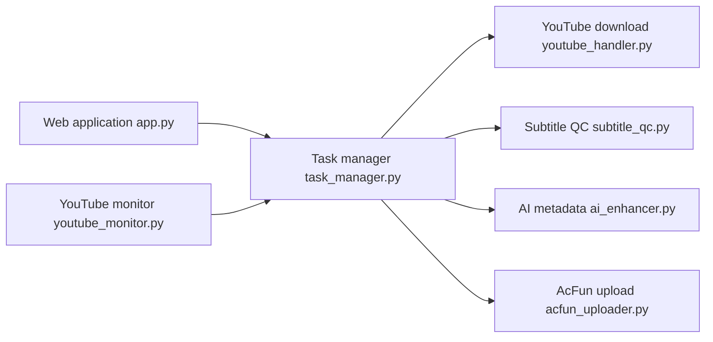

# fqscfqj/Y2A-Auto

> Tool that automates transferring YouTube videos to AcFun and bilibili, with subtitles and a web back office.

## The problem
Republishing YouTube videos on Chinese platforms requires downloading, translated subtitles, metadata and uploading by hand.

## What it actually does
Pipeline: yt-dlp, speech recognition (Whisper, Voxtral), subtitle translation and quality control, burn-in, AI-generated title/description/tags, moderation (Aliyun), transcoding (CPU, NVIDIA, Intel, AMD), upload. Flask back office, YouTube channel monitoring, notifications (WeChat Work, Server酱), CookieCloud.

## How it is wired


## Trying it
```bash
docker compose up -d
docker compose -f docker-compose-build.yml up -d --build
```

## Cost and gotchas
YouTube, AcFun and bilibili cookies must be supplied (do not commit them). OpenAI, YouTube Data API and Aliyun keys depending on the modules. Web password disabled by default: do not expose port 5000.

## What it is not
Not a neutral tool: republishing content raises copyright and platform terms issues (the README asks for lawful use). GPL-3.0 license.

## Alternatives
No alternative named in the README.

## For you
Ignore: niche (YouTube to Chinese platforms), copyleft and compliance risks, unrelated to a data/AI profile.
