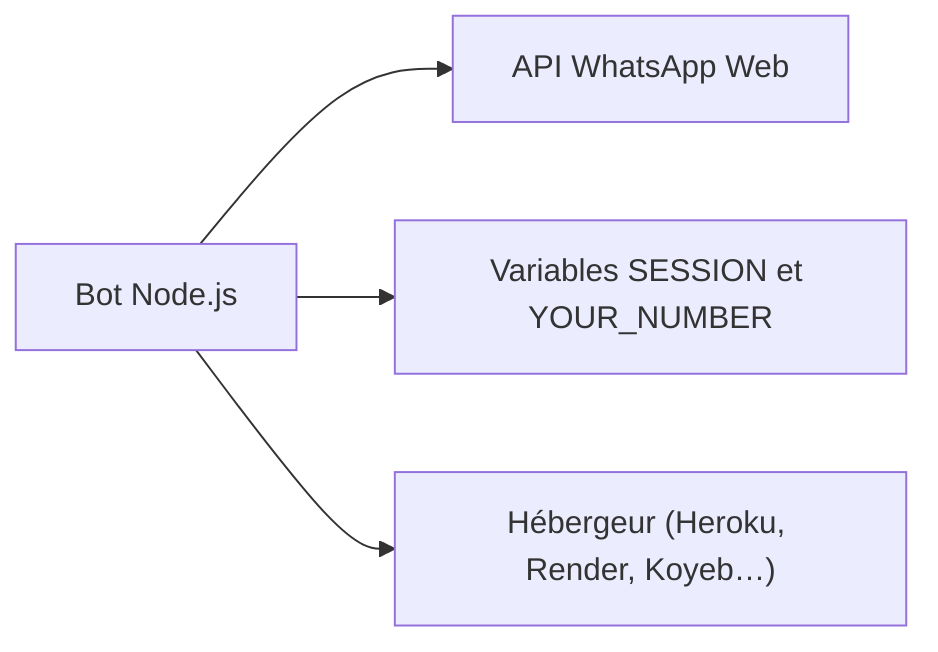

# franceking1/Flash-Md-V2

> Node.js WhatsApp bot for automating tasks and managing groups, deployable on several hosts.

## The problem
Automating replies and WhatsApp group management without writing a bot.

## What it actually does
Node.js bot built on the WhatsApp Web API; it needs a session ID obtained through a separate tool, then the variables `SESSION`, `YOUR_NUMBER`, `YOUR_LID`. The README lists Heroku, Render, Koyeb, Railway, Bot-Hosting, Optiklink and Termux. The README talks about FLASH-MD-V3 while the repository is named V2.

## How it is wired
Simplified diagram based on the sheet, no diagram provided.



## Trying it
```bash
git clone https://github.com/franceking1/FLASH-MD-V3.git
cd FLASH-MD-V3
npm install
npm start
```

## Cost and gotchas
Free, but Heroku requires a credit card. Depends on WhatsApp Web (unofficial use, risk of the number being banned, undocumented).

## What it is not
Not an official API. The README forbids copying or redistributing "without permission" while the license is GPL-3.0: a contradiction worth noting.

## Alternatives
No alternative named in the README.

## For you
Ignore: unofficial WhatsApp bot, unrelated to data or AI, with an ambiguous license and a risk to your number.
