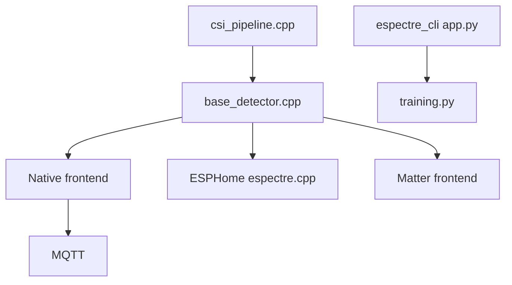

# francescopace/espectre

> ESP32 firmware that detects motion in a room through Wi-Fi disturbances, without a camera.

## The problem
Detecting presence without a camera, microphone or dedicated radar, and without sending raw data to a cloud.

## What it actually does
Reads the CSI (Wi-Fi channel state) on the ESP32, evaluates motion locally and publishes a state and a score. Four firmware paths: Native (MQTT, direct HTTP API), ESPHome (Home Assistant), Matter (validation still limited) and Micro-ESPectre (MicroPython). Also publishes a CSI dataset, model weights and the training workflow.

## How it is wired


## Trying it
```bash
./espectre --help
```
The quick path goes through the browser: Flash in Chrome or Edge, ESP32 plugged in via USB.

## Cost and gotchas
Free, but you need a compatible ESP32. One sensor per zone. Chrome 151+ recommended for the hosted tool. Presence data reveals routines: consent and the right to deploy are required.

## What it is not
Does not count or identify anyone, does not prove that a room is empty, does not replace a certified security system. Matter: controller compatibility not validated.

## Alternatives
No alternative named in the README.

## For you
Watch: the CSI dataset, the open weights and the registry of tested features are real material for an embedded data/ML profile; keep GPL-3.0 in mind if you integrate the code.
