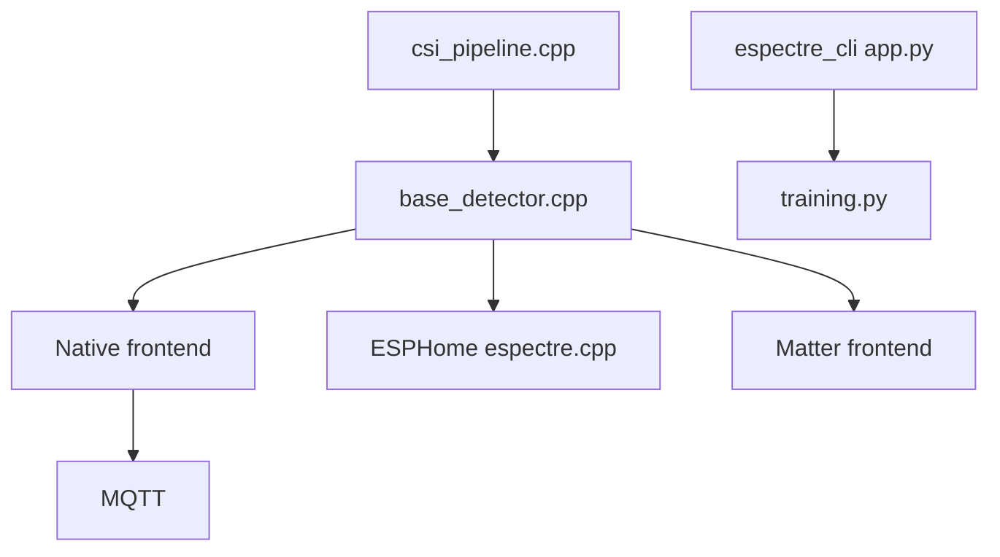

# francescopace/espectre

> Firmware ESP32 qui détecte le mouvement dans une pièce via les perturbations du Wi-Fi, sans caméra.

## Le problème
Détecter une présence sans caméra, micro ni radar dédié, et sans envoyer de données brutes dans un cloud.

## Ce que ça fait vraiment
Lit le CSI (état du canal Wi-Fi) sur l'ESP32, évalue le mouvement localement et publie un état et un score. Quatre voies de firmware : Native (MQTT, API HTTP directe), ESPHome (Home Assistant), Matter (validation encore limitée) et Micro-ESPectre (MicroPython). Publie aussi un jeu de données CSI, des poids de modèles et le workflow d'entraînement.

## Comment c'est branché


## Essayer
```bash
./espectre --help
```
Le chemin rapide passe par le navigateur : Flash dans Chrome ou Edge, ESP32 branché en USB.

## Coût et pièges
Gratuit, mais il faut un ESP32 compatible. Un capteur par zone. Chrome 151+ recommandé pour l'outil hébergé. Les données de présence révèlent des routines : consentement et droit de déployer requis.

## Ce que ce n'est pas
Ne compte ni n'identifie personne, ne prouve pas qu'une pièce est vide, ne remplace pas un système de sécurité certifié. Matter : compatibilité contrôleurs non validée.

## Alternatives
Aucune alternative nommée dans le README.

## Pour toi
Surveiller : le dataset CSI, les poids ouverts et le registre des features testées sont une vraie matière pour un profil data/ML embarqué ; GPL-3.0 à garder en tête si tu intègres le code.

