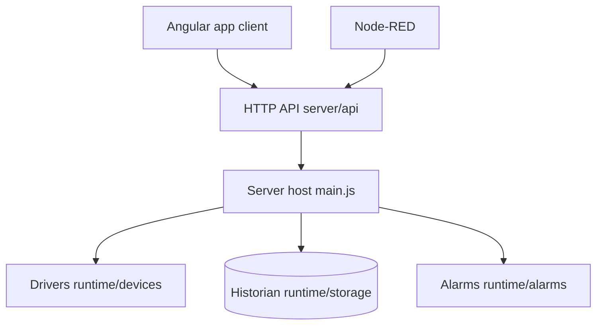

# frangoteam/FUXA

> Web SCADA/HMI platform to supervise industrial machines via Modbus, OPC-UA, MQTT, S7 and other protocols.

## The problem
Supervising PLCs and sensors calls for heavy, proprietary SCADA software that is barely web-based.

## What it actually does
A Node.js server drives protocol drivers and stores values (SQLite, InfluxDB, QuestDB, TDengine). An Angular editor in the browser draws views, gauges, alarms and reports. Scripts, a scheduler and Node-RED nodes allow automation. It also exists as Electron and as a headless binary.

## How it is wired


## Trying it
```bash
docker pull frangoteam/fuxa:latest
docker run -d -p 1881:1881 frangoteam/fuxa:latest
# puis ouvrir http://localhost:1881
```

## Cost and gotchas
Open source MIT, but a FUXA Pro edition at 100 euros adds white labeling and logs. Native dependencies (node-snap7, odbc) are tricky on Linux. 440 open issues.

## What it is not
It is not a data science tool: it is industrial acquisition. The README says nothing about the security required for production use.

## Alternatives
No alternative named in the README.

## For you
Worth watching: useful if you work on industrial sensor data, off-topic for a classic ML pipeline.
