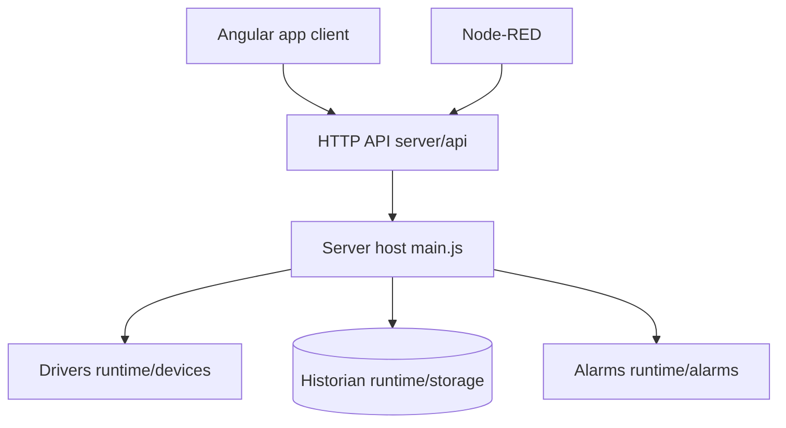

# frangoteam/FUXA

> Plateforme web SCADA/HMI pour superviser des machines industrielles via Modbus, OPC-UA, MQTT, S7 et d'autres protocoles.

## Le problème
Superviser des automates et des capteurs demande des logiciels SCADA lourds, propriétaires et peu web.

## Ce que ça fait vraiment
Un serveur Node.js pilote des pilotes de protocoles et stocke les valeurs (SQLite, InfluxDB, QuestDB, TDengine). Un éditeur Angular dans le navigateur dessine les vues, jauges, alarmes et rapports. Scripts, planificateur et nœuds Node-RED permettent d'automatiser. Il existe aussi en Electron et en binaire sans interface.

## Comment c'est branché


## Essayer
```bash
docker pull frangoteam/fuxa:latest
docker run -d -p 1881:1881 frangoteam/fuxa:latest
# puis ouvrir http://localhost:1881
```

## Coût et pièges
Open source MIT, mais une édition FUXA Pro à 100 € ajoute marque blanche et journaux. Les dépendances natives (node-snap7, odbc) sont délicates sous Linux. 440 issues ouvertes.

## Ce que ce n'est pas
Ce n'est pas un outil de data science : c'est de l'acquisition industrielle. Le README ne dit rien de la sécurité requise pour un usage en production.

## Alternatives
Aucune alternative nommée dans le README.

## Pour toi
À surveiller : utile si tu travailles sur des données de capteurs industriels, hors sujet pour un pipeline ML classique.

