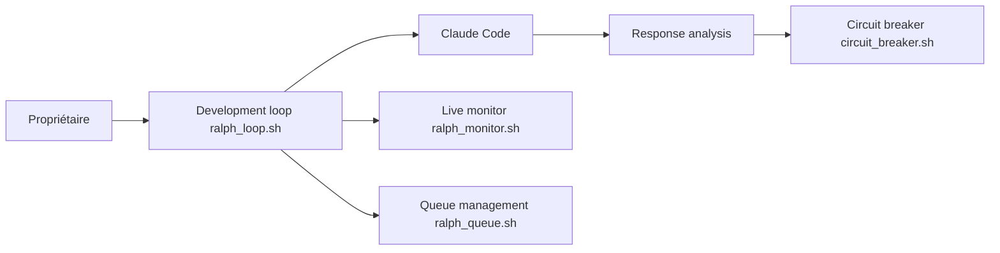

# frankbria/ralph-claude-code

> Autonomous Bash loop that reruns Claude Code until the project is done, with safeguards.

## The problem
Letting an agent work alone on long tasks risks infinite loops, quota overruns and premature stops.

## What it actually does
Rereads `.ralph/PROMPT.md`, calls Claude Code, analyzes the response and decides whether to continue. Exit requires two conditions: completion indicators and `EXIT_SIGNAL: true`. Hourly call limits, circuit breaker, session resume, tmux monitor, import of PRDs or GitHub issues, queue, Docker or E2B sandbox. 784 tests claimed.

## How it is wired


## Trying it
```bash
git clone https://github.com/frankbria/ralph-claude-code.git
cd ralph-claude-code
./install.sh
cd my-existing-project
ralph-enable
ralph --monitor
```

## Cost and gotchas
Consumes your Claude quota (100 calls/h by default, one call can exceed 100,000 tokens). Requires Bash 4, jq, tmux, GNU coreutils. The `.ralphrc` file is no longer executed (unpublished breaking change).

## What it is not
Not an agent itself: just a loop orchestrator. It needs clear tasks in `fix_plan.md`. Support for other CLIs is "in progress".

## Alternatives
None named in the README apart from Claude Code and Aider (cited as references).

## For you
Keep an eye on it: useful for long unattended jobs, to be used only with the Docker sandbox and a token cap.
