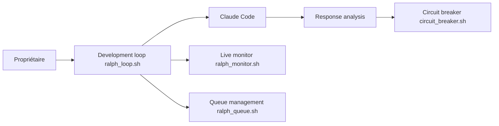

# frankbria/ralph-claude-code

> Boucle autonome en Bash qui relance Claude Code jusqu'à fin du projet, avec garde-fous.

## Le problème
Laisser un agent travailler seul sur de longues tâches risque boucles infinies, dépassements de quota et arrêts prématurés.

## Ce que ça fait vraiment
Relit `.ralph/PROMPT.md`, appelle Claude Code, analyse la réponse et décide de continuer. La sortie exige deux conditions : indicateurs de fin et `EXIT_SIGNAL: true`. Limites d'appels par heure, disjoncteur, reprise de session, moniteur tmux, import de PRD ou d'issues GitHub, file d'attente, bac à sable Docker ou E2B. 784 tests annoncés.

## Comment c'est branché


## Essayer
```bash
git clone https://github.com/frankbria/ralph-claude-code.git
cd ralph-claude-code
./install.sh
cd my-existing-project
ralph-enable
ralph --monitor
```

## Coût et pièges
Consomme ton quota Claude (100 appels/h par défaut, un appel peut dépasser 100 000 tokens). Exige Bash 4, jq, tmux, GNU coreutils. Le fichier `.ralphrc` n'est plus exécuté (changement cassant non publié).

## Ce que ce n'est pas
Pas un agent en soi : un simple orchestrateur de boucle. Il faut des tâches claires dans `fix_plan.md`. La prise en charge d'autres CLI est « en cours ».

## Alternatives
Aucune nommée dans le README hors Claude Code et Aider (cités comme références).

## Pour toi
À surveiller : utile pour des chantiers longs sans surveillance, à n'utiliser qu'avec le bac à sable Docker et un plafond de tokens.

