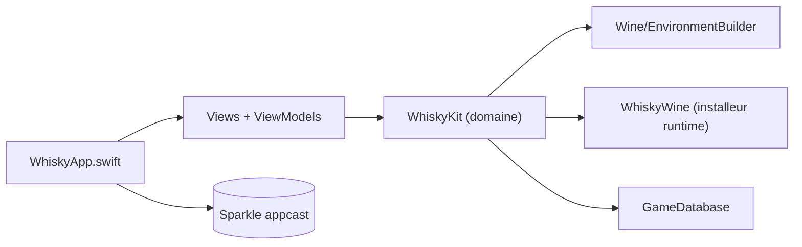

# frankea/Whisky

> Active fork of a SwiftUI front end for Wine on Apple Silicon Macs, for running Windows games.

## The problem
Running Windows applications and games on macOS through Wine requires manual configuration. The original was archived in April 2025.

## What it actually does
Creates and manages Wine "bottles", installs a Wine 11 runtime (~330 MB on first run), translates DirectX 11 to Metal (DXMT) or via DXVK/MoltenVK, and handles launchers (Steam, Epic, etc.). A game database applies settings, a troubleshooting engine produces redacted diagnostic reports, and an import command pulls in bottles from the original.

## How it is wired


## Trying it
```bash
brew install --cask frankea/whisky/whisky
brew uninstall --cask frankea/whisky/whisky
```

## Cost and gotchas
Free; Apple Silicon and macOS 15 required. The Homebrew cask without the prefix installs the archived original. Optional PostHog telemetry, off by default.

## What it is not
Not affiliated with the original nor with CrossOver. The README admits a single maintainer (low bus factor) and recommends CrossOver for commercial support.

## Alternatives
- CrossOver (CodeWeavers): commercial, supported Wine.
- whisky-app/whisky: the original, archived.

## For you
Ignore: a gaming tool for Mac, unrelated to data/AI/MLOps.
