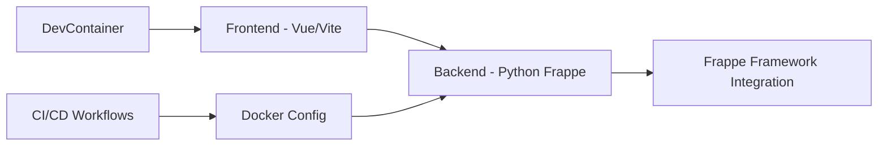

# frappe/builder

> Low-code site builder with a visual editor, integrated into the Frappe ecosystem, for designers and developers.

## The problem
Existing page builders are heavy, restrictive or poorly integrated with Frappe, and produce pages loaded with unnecessary scripts.

## What it actually does
Figma-style visual editor (Vue, Frappe UI) with one-click publishing, responsive views, dark mode, a CMS via the Frappe framework, per-block scripts, page analytics and an AI agent ("Bob") that reads existing pages, wires forms to doctypes and whose every change can be undone. A skill also lets you drive Builder from a coding agent.

## How it is wired


## Trying it
```bash
wget https://frappe.io/easy-install.py
python3 ./easy-install.py deploy \
    --project=builder_prod_setup \
    --email=email@example.com \
    --image=ghcr.io/frappe/builder \
    --version=stable \
    --app=builder \
    --sitename subdomain.domain.tld
npx skills add frappe/builder
```

## Cost and gotchas
Free self-hosting (Docker) or paid hosting on Frappe Cloud. Default dev credentials `Administrator` / `admin`: change them. The model provider of the AI agent is not specified.

## What it is not
Not a standalone tool: it assumes the Frappe framework. Not a general-purpose no-code application outside this ecosystem.

## Alternatives
None named in the README.

## For you
Worth watching: interesting if you already have a Frappe/ERPNext instance and want pages linked to your data; otherwise off-topic.
