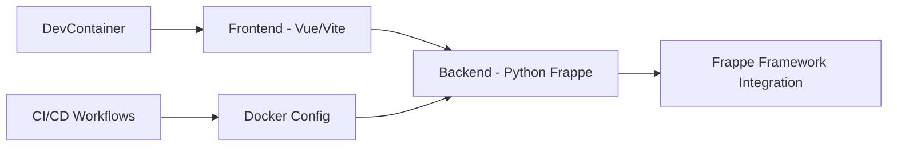

# frappe/builder

> Constructeur de sites low-code à éditeur visuel, intégré à l'écosystème Frappe, pour designers et développeurs.

## Le problème
Les constructeurs de pages existants sont lourds, restrictifs ou mal intégrés à Frappe, et produisent des pages chargées de scripts inutiles.

## Ce que ça fait vraiment
Éditeur visuel façon Figma (Vue, Frappe UI) avec publication en un clic, vues responsives, mode sombre, CMS via le framework Frappe, scripts par bloc, analytics de pages et un agent IA (« Bob ») qui lit les pages existantes, câble les formulaires aux doctypes et dont chaque modification est annulable. Un skill permet aussi de piloter Builder depuis un agent de code.

## Comment c'est branché


## Essayer
```bash
wget https://frappe.io/easy-install.py
python3 ./easy-install.py deploy \
    --project=builder_prod_setup \
    --email=email@example.com \
    --image=ghcr.io/frappe/builder \
    --version=stable \
    --app=builder \
    --sitename subdomain.domain.tld
npx skills add frappe/builder
```

## Coût et pièges
Auto-hébergement gratuit (Docker) ou hébergement payant Frappe Cloud. Identifiants de dev par défaut `Administrator` / `admin` : à changer. Le fournisseur du modèle de l'agent IA n'est pas précisé.

## Ce que ce n'est pas
Pas un outil autonome : il suppose le framework Frappe. Pas une application no-code généraliste hors de cet écosystème.

## Alternatives
Aucune nommée dans le README.

## Pour toi
Surveiller : intéressant si tu as déjà une instance Frappe/ERPNext et veux des pages liées à tes données ; sinon hors sujet.

