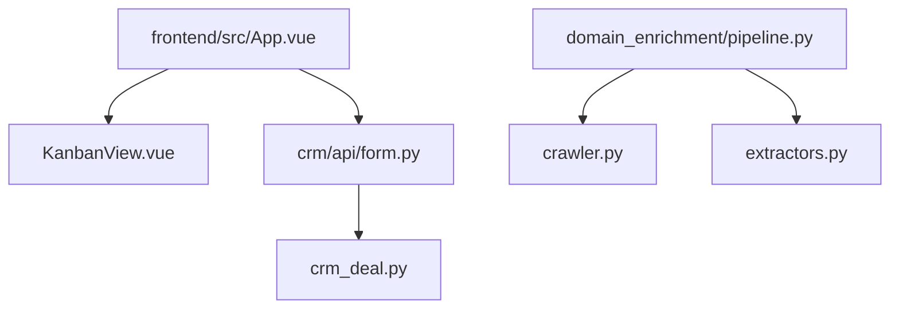

# frappe/crm

> Open CRM for sales teams, built on the Frappe framework, with unlimited users.

## The problem
CRMs are either too complex, too expensive or too rigid for a growing sales team.

## What it actually does
A single page per lead or deal (activities, notes, tasks), Kanban view, custom views. Twilio and Exotel integrations for calls, WhatsApp via Frappe WhatsApp, ERPNext for invoicing. An enrichment pipeline crawls a company's website to fill in fields. Vue interface on Frappe.

## How it is wired


## Trying it
```bash
wget https://frappe.io/easy-install.py
python3 ./easy-install.py deploy --project=crm_prod_setup --email=email.example.com --image=ghcr.io/frappe/crm --version=stable --app=crm --sitename subdomain.domain.tld
```

## Cost and gotchas
Self-hosting is free; managed hosting is paid via Frappe Cloud. Docker required. Compatible with Frappe v15 and v16 on the main branch. Default Docker credentials Administrator/admin, to be changed. 334 open issues.

## What it is not
Not an ERP: accounting goes through ERPNext. Not a data analysis or ML tool.

## Alternatives
No alternative named in the README.

## For you
Ignore: business CRM, unrelated to data, AI or MLOps work.
