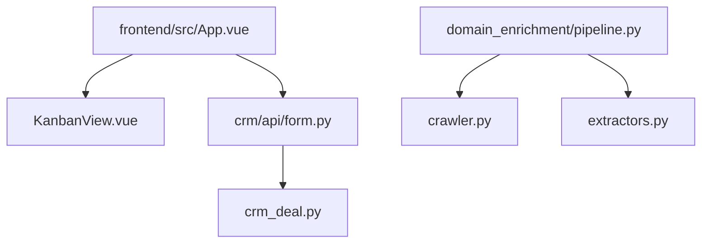

# frappe/crm

> CRM ouvert pour équipes commerciales, construit sur le framework Frappe, avec utilisateurs illimités.

## Le problème
Les CRM sont soit trop complexes, soit trop chers ou trop rigides pour une équipe commerciale qui grandit.

## Ce que ça fait vraiment
Page unique par lead ou affaire (activités, notes, tâches), vue Kanban, vues personnalisées. Intégrations Twilio et Exotel pour les appels, WhatsApp via Frappe WhatsApp, ERPNext pour la facturation. Une chaîne d'enrichissement explore le site web d'une entreprise pour remplir des champs. Interface Vue sur Frappe.

## Comment c'est branché


## Essayer
```bash
wget https://frappe.io/easy-install.py
python3 ./easy-install.py deploy --project=crm_prod_setup --email=email.example.com --image=ghcr.io/frappe/crm --version=stable --app=crm --sitename subdomain.domain.tld
```

## Coût et pièges
Auto-hébergement gratuit ; hébergement géré payant via Frappe Cloud. Docker nécessaire. Compatible Frappe v15 et v16 sur la branche principale. Identifiants Docker par défaut Administrator/admin, à changer. 334 issues ouvertes.

## Ce que ce n'est pas
Pas un ERP : la comptabilité passe par ERPNext. Pas un outil d'analyse de données ni de ML.

## Alternatives
Aucune alternative nommée dans le README.

## Pour toi
À ignorer : CRM métier, sans rapport avec un travail data, IA ou MLOps.

