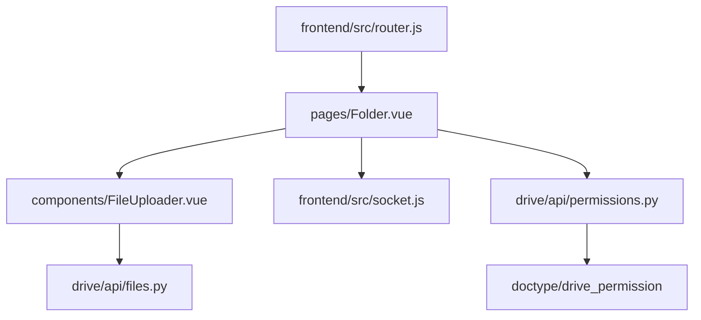

# frappe/drive

> Self-hostable file storage, sharing and collaborative editing, built on the Frappe framework.

## The problem
Teams want an open file cloud, without depending on a proprietary service.

## What it actually does
File manager (multipart uploads, previews, sharing, quotas, activity log) and collaborative document editor (TipTap, ProseMirror, YJS) with versions. Vue frontend calling Python APIs and Frappe doctypes. The README states that Frappe Drive is archived and merged into Suite.

## How it is wired


## Trying it
```bash
mkdir frappe-drive && cd frappe-drive
wget -O docker-compose.yml https://raw.githubusercontent.com/frappe/drive/main/docker/docker-compose.yml
wget -O init.sh https://raw.githubusercontent.com/frappe/drive/main/docker/init.sh
docker compose up -d
```

## Cost and gotchas
Docker or bench. Plan your own backups: the README advises against making it your only storage. AGPL-3.0 license. Archival announcement in favor of Suite.

## What it is not
Not a data or MLOps tool. Not the active suite, according to the README.

## Alternatives
No alternative named in the README.

## For you
Generic file storage, of no interest for data / AI, and a project announced as archived: ignore.
