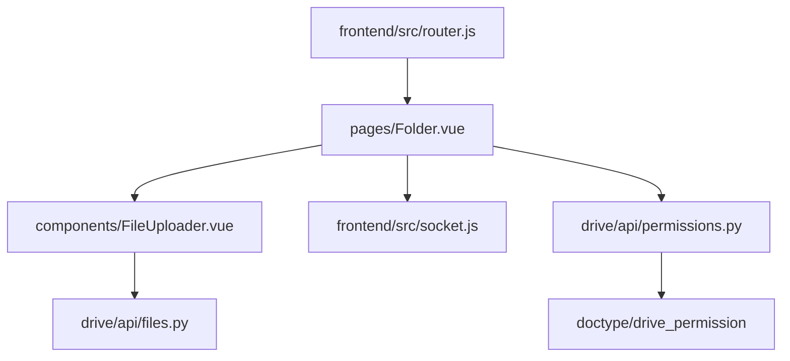

# frappe/drive

> Stockage, partage et édition collaborative de fichiers auto-hébergeable, bâti sur le framework Frappe.

## Le problème
Les équipes veulent un cloud de fichiers ouvert, sans dépendre d'un service propriétaire.

## Ce que ça fait vraiment
Gestionnaire de fichiers (envois multipart, aperçus, partage, quotas, journal d'activité) et éditeur de documents collaboratif (TipTap, ProseMirror, YJS) avec versions. Frontend Vue qui appelle des API Python et des doctypes Frappe. Le README indique que Frappe Drive est archivé et intégré à Suite.

## Comment c'est branché


## Essayer
```bash
mkdir frappe-drive && cd frappe-drive
wget -O docker-compose.yml https://raw.githubusercontent.com/frappe/drive/main/docker/docker-compose.yml
wget -O init.sh https://raw.githubusercontent.com/frappe/drive/main/docker/init.sh
docker compose up -d
```

## Coût et pièges
Docker ou bench. Prévoir ses propres sauvegardes : le README déconseille d'en faire l'unique stockage. Licence AGPL-3.0. Annonce d'archivage au profit de Suite.

## Ce que ce n'est pas
Pas un outil de données ni de MLOps. Pas la suite active, d'après le README.

## Alternatives
Aucune alternative nommée dans le README.

## Pour toi
Stockage de fichiers générique, sans intérêt data / IA, et projet annoncé comme archivé : à ignorer.

