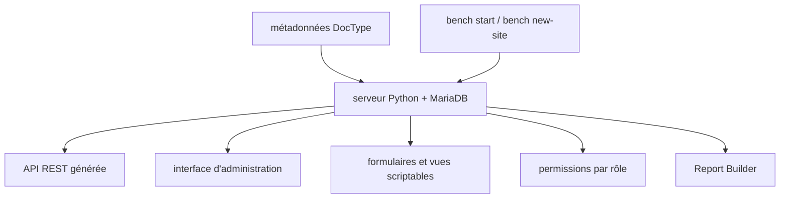

# frappe/frappe

> Full-stack Python/MariaDB metadata-driven web framework, designed for large business applications.

## The problem
Business applications get built around the interface, not around the semantics of the objects they manipulate, and become inconsistent.
Each new object forces you to rewrite forms, permissions, APIs and reports.

## What it actually does
Defines objects through metadata: the admin interface, role-based permissions and the REST API are generated for all models.
Python and MariaDB on the server side, a built-in client library in the browser; forms and views customizable by server script and client JavaScript.
A Report Builder lets you create reports without writing code.
First application built on it: ERPNext, with more than 700 object types.

## How it is wired


## Trying it
```
git clone https://github.com/frappe/frappe_docker
cd frappe_docker
docker compose -f pwd.yml up -d
bench start
bench new-site frappe.localhost
```

## Cost and gotchas
Free when self-hosted; Frappe Cloud is the same vendor's paid managed offering.
The default account of the Docker image is `Administrator` / `admin`: change it before any exposure. The manual installation script generates and writes passwords to `~/frappe_passwords.txt`.

## What it is not
Not a framework for beginners: the README says it is not "for the faint of heart" and advises against learning it first.
Not ERPNext: it is the layer underneath, ERPNext being its flagship application.
Not database-agnostic: MariaDB is baked in from the start.

## Alternatives
- frappe/bench: the installation and operations tool, a complement and not a substitute.
- frappe/frappe_docker: the Docker route, including ARM.

## For you
Outside the data/AI scope: ignore unless you have to take over an ERPNext application.
