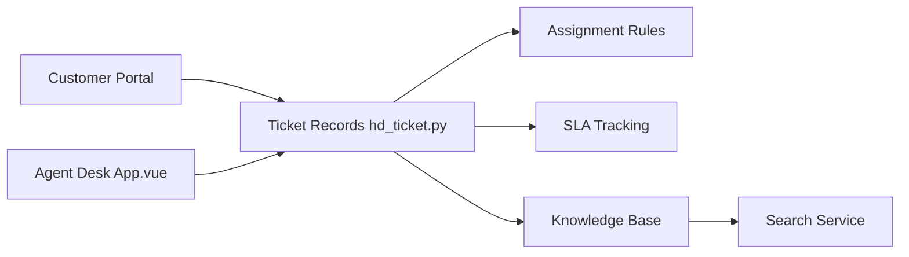

# frappe/helpdesk

> Self-hosted support ticket management tool, built on Frappe, for support teams.

## The problem
Handling customer requests with ERPNext's unergonomic module slows teams down.

## What it actually does
Agent portal and customer portal, customizable SLAs, assignment rules, knowledge base with search, saved replies. Python backend on Frappe, Vue interface (Frappe UI), built-in telephony and analytics.

## How it is wired


## Trying it
```bash
wget https://frappe.io/easy-install.py
python3 ./easy-install.py deploy --project=helpdesk_prod_setup --email=your_email.example.com --image=ghcr.io/frappe/helpdesk --version=stable --app=helpdesk --sitename subdomain.domain.tld
```

## Cost and gotchas
Docker, domain name; article search requires Redis with RediSearch. Managed hosting available via Frappe Cloud (paid, price not given in the README). AGPL-3.0.

## What it is not
Not a data/AI tool. Compatibility is tied to specific Frappe versions.

## Alternatives
- None cited in the README.

## For you
Ignore: customer support unrelated to data/AI/MLOps.
