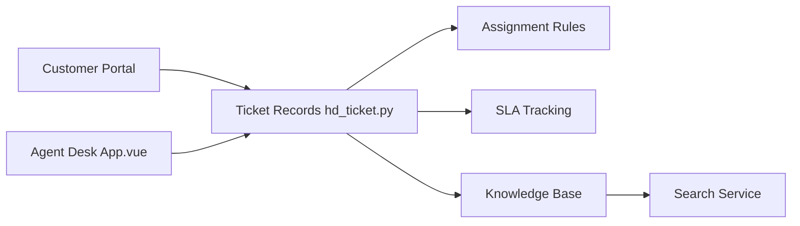

# frappe/helpdesk

> Outil de gestion de tickets de support auto-hébergé, construit sur Frappe, pour équipes de support.

## Le problème
Gérer les demandes clients avec un module peu ergonomique d'ERPNext freine les équipes.

## Ce que ça fait vraiment
Portail agent et portail client, SLA personnalisables, règles d'affectation, base de connaissances avec recherche, réponses enregistrées. Backend Python sur Frappe, interface Vue (Frappe UI), téléphonie intégrée et analytique.

## Comment c'est branché


## Essayer
```bash
wget https://frappe.io/easy-install.py
python3 ./easy-install.py deploy --project=helpdesk_prod_setup --email=your_email.example.com --image=ghcr.io/frappe/helpdesk --version=stable --app=helpdesk --sitename subdomain.domain.tld
```

## Coût et pièges
Docker, domaine ; la recherche d'articles exige Redis avec RediSearch. Hébergement géré possible via Frappe Cloud (payant, non chiffré dans le README). AGPL-3.0.

## Ce que ce n'est pas
Pas un outil data/IA. Compatibilité liée à des versions précises de Frappe.

## Alternatives
- Aucune citée dans le README.

## Pour toi
À ignorer : support client sans lien avec data/IA/MLOps.

