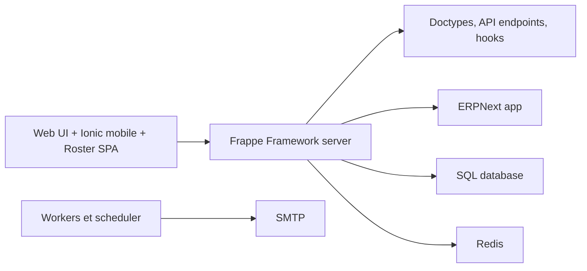

# frappe/hrms

> Frappe HR: open-source human resources and payroll software, built on the Frappe framework.

## The problem
Manage employees, leave, expense claims and payroll without proprietary HR software.

## What it actually does
More than thirteen modules: employee lifecycle, leave and attendance (geolocated check-in), expense claims with approval workflows, performance appraisal, payroll and taxation, mobile app. It relies on Frappe Framework (Python/JS) and Frappe UI (Vue). It pairs with ERPNext, separate since version 14. The architecture described from the code adds a roster SPA, MariaDB, Redis and workers.

## How it is wired


## Trying it
```bash
git clone https://github.com/frappe/hrms
cd hrms/docker
docker-compose up
```
The site responds at http://localhost:8000 (development credentials: Administrator / admin).

## Cost and gotchas
Free when self-hosted; Frappe Cloud is offered as managed hosting. Don't keep the default credentials outside a test machine. 479 open issues.

## What it is not
Not an HR reporting module or an analytics tool: it is a transactional management application.

## Alternatives
The README cites ERPNext, from which HRMS originates, as a coupled foundation rather than as a rival.

## For you
Ignore: HR software unrelated to data/AI work, under GPL-3.0; consider it only if your company is looking for a free HRMS.
