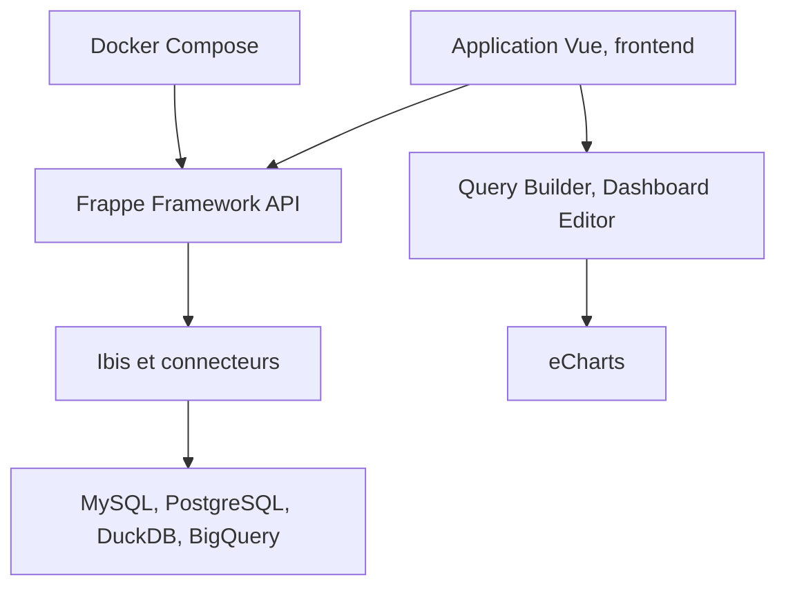

# frappe/insights

> Open-source BI tool to build queries, charts and dashboards without writing SQL.

## The problem
Extracting figures from Frappe applications forces non-technical teams to write SQL for every report.

## What it actually does
It connects several sources (MySQL, PostgreSQL, DuckDB, BigQuery, files). A query builder guides joins, filters and calculations, via Ibis. Results are visualized with eCharts, which suggests a suitable chart, and assembled into dashboards by drag and drop with filters.

## How it is wired


## Trying it
```bash
wget https://frappe.io/easy-install.py
docker compose up -d
bench get-app insights
bench new-site insights.test --install-app insights
```
In development, the site responds at `http://insights.localhost:8000/insights` (Administrator / admin).

## Cost and gotchas
Free when self-hosted; Frappe Cloud is offered as managed hosting, pricing not detailed. Server Scripts must be enabled. Branches are tied to specific versions of Frappe, Node and Python.

## What it is not
Not a data warehouse nor an ETL tool. It reads your existing databases; the AGPL license applies if exposed to third parties.

## Alternatives
No alternative named in the README.

## For you
Worth watching: a lightweight free BI alternative to expose analyses to non-technicians, with DuckDB and BigQuery in the catalog.
