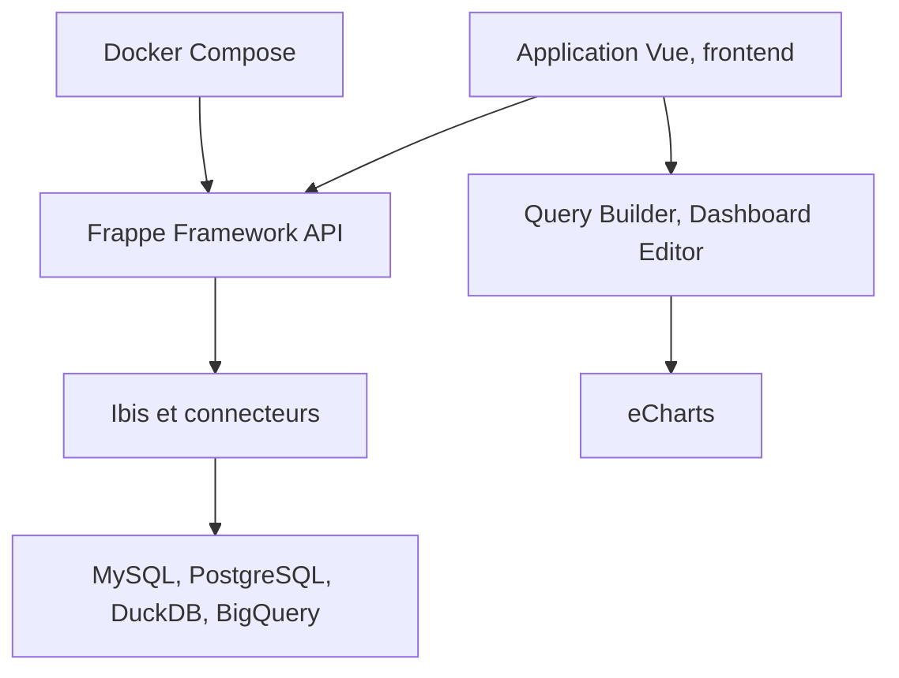

# frappe/insights

> Outil de BI open source pour créer requêtes, graphiques et tableaux de bord sans écrire de SQL.

## Le problème
Extraire des chiffres d'applications Frappe oblige les équipes non techniques à écrire du SQL pour chaque rapport.

## Ce que ça fait vraiment
Il connecte plusieurs sources (MySQL, PostgreSQL, DuckDB, BigQuery, fichiers). Un constructeur de requêtes guide les jointures, filtres et calculs, via Ibis. Les résultats se visualisent avec eCharts, qui suggère un graphique adapté, et s'assemblent en tableaux de bord par glisser-déposer avec filtres.

## Comment c'est branché


## Essayer
```bash
wget https://frappe.io/easy-install.py
docker compose up -d
bench get-app insights
bench new-site insights.test --install-app insights
```
En développement, le site répond sur `http://insights.localhost:8000/insights` (Administrator / admin).

## Coût et pièges
Gratuit en auto-hébergement ; Frappe Cloud est proposé en hébergement géré, tarif non détaillé. Il faut activer les Server Scripts. Branches liées à des versions précises de Frappe, Node et Python.

## Ce que ce n'est pas
Pas un entrepôt de données ni un outil d'ETL. Il lit tes bases existantes, la licence AGPL s'applique en cas d'exposition à des tiers.

## Alternatives
Aucune alternative nommée dans le README.

## Pour toi
À surveiller : alternative légère de BI libre pour exposer des analyses à des non-techniciens, avec DuckDB et BigQuery au catalogue.

