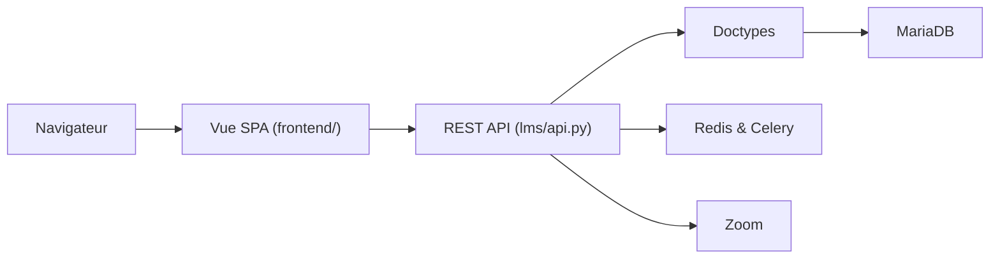

# frappe/lms

> Open source online learning platform for creating courses, quizzes and certificates.

## The problem
Traditional LMSs like Moodle have long forms and a confusing interface for publishing a course.

## What it actually does
A course is made of chapters and lessons. You can add quizzes, assignments, learner batches with Zoom classes, and certificates. The server is built on the Frappe framework (Python, MariaDB, Redis); the front end is a Vue application with Frappe UI.

## How it is wired


## Trying it
```bash
wget https://frappe.io/easy-install.py
python3 ./easy-install.py deploy \
    --project=learning_prod_setup \
    --email=your_email.example.com \
    --image=ghcr.io/frappe/lms \
    --version=stable \
    --app=lms \
    --sitename subdomain.domain.tld
```

## Cost and gotchas
Free self-hosting, or Frappe Cloud as an option. Zoom is required for live classes. AGPL-3.0 license.

## What it is not
Not a model-training tool. Not a managed service by default.

## Alternatives
- Moodle: cited as a starting point, dismissed by the author for its interface.

## For you
Ignore for your line of work: only useful if you need to set up an internal training platform.
