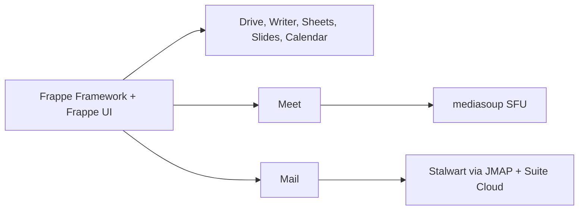

# frappe/suite

> Frappe's collaborative office suite: files, documents, spreadsheets, slides, video calls, mail and calendar.

## The problem
Collaboration tools (files, documents, mail, video calls) are scattered across several services to host.

## What it actually does
Groups seven products (Drive, Writer, Sheets, Slides, Meet, Mail, Calendar) in a single Frappe app. Yjs and Hocuspocus synchronize real-time editing, mediasoup serves group video calls. Mail goes through Stalwart clusters (JMAP) managed by a separate app, Suite Cloud.

## How it is wired
Simplified diagram based on the sheet, no diagram provided.


## Trying it
```bash
bench get-app https://github.com/frappe/suite
bench new-site suite.localhost --install-app suite
bench start
cd apps/suite && yarn install && yarn dev
```

## Cost and gotchas
Free but heavy: bench, Frappe site, separate SFU server for Meet, Suite Cloud for mail administration. Installation is impossible if the old standalone apps are present: migrate by backing up then uninstalling (which erases their data).

## What it is not
Not a mail server: it does not administer any. Not a data / AI tool.

## Alternatives
None named in the README.

## For you
Ignore: office suite unrelated to data / AI / MLOps work, and AGPL license with a sharing clause.
