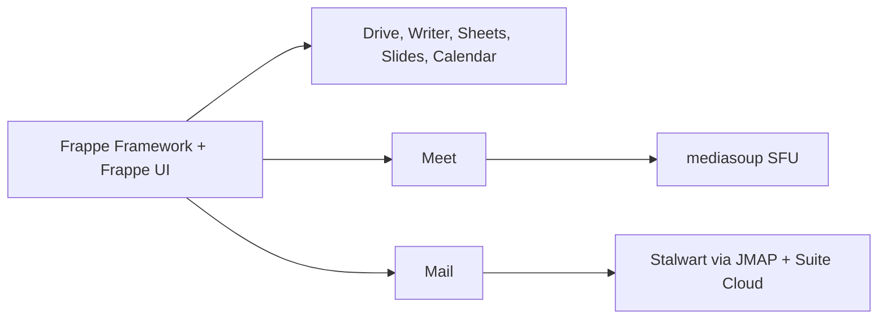

# frappe/suite

> Suite bureautique collaborative de Frappe : fichiers, documents, tableurs, slides, visio, mail et agenda.

## Le problème
Les outils de collaboration (fichiers, documents, mail, visio) sont dispersés entre plusieurs services à héberger.

## Ce que ça fait vraiment
Regroupe sept produits (Drive, Writer, Sheets, Slides, Meet, Mail, Calendar) dans une seule app Frappe. Yjs et Hocuspocus synchronisent l'édition en temps réel, mediasoup sert les appels vidéo de groupe. Le mail passe par des clusters Stalwart (JMAP) gérés par une app séparée, Suite Cloud.

## Comment c'est branché
Schéma simplifié d'après la fiche, sans diagramme fourni.


## Essayer
```bash
bench get-app https://github.com/frappe/suite
bench new-site suite.localhost --install-app suite
bench start
cd apps/suite && yarn install && yarn dev
```

## Coût et pièges
Gratuit mais lourd : bench, site Frappe, serveur SFU séparé pour Meet, Suite Cloud pour l'administration mail. Installation impossible si les anciennes apps autonomes sont présentes : migration par sauvegarde puis désinstallation (qui efface leurs données).

## Ce que ce n'est pas
Ce n'est pas un serveur mail : il n'en administre aucun. Pas un outil data / IA.

## Alternatives
Aucune nommée dans le README.

## Pour toi
Ignorer : suite bureautique sans rapport avec un travail data / IA / MLOps, et licence AGPL à clause de partage.

