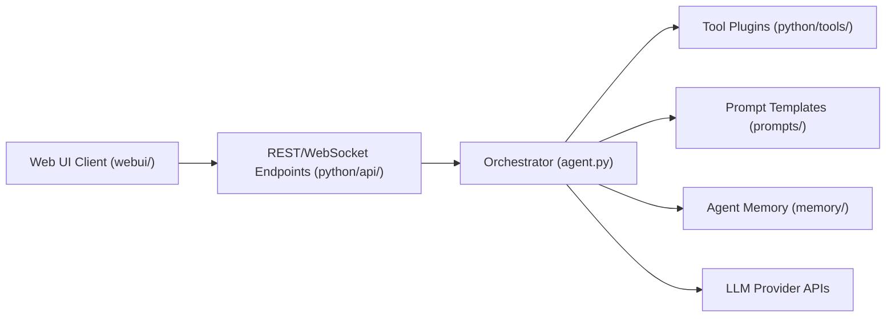

# frdel/agent-zero

> Open-source agent framework that gives the AI a Dockerized Linux desktop, a browser and shared documents.

## The problem
An agent limited to chat cannot use graphical applications or edit files with you live.

## What it actually does
Launches in Docker an XFCE Linux desktop, a browser with DOM annotation, and shared Markdown and LibreOffice editors. The agent uses isolated projects (memory, secrets, repositories), skills, agent profiles, model presets, sub-agents, plugins, MCP and A2A. A `a0` CLI connector extends the agent to your host machine. Time Travel keeps the history of workspaces. Connection to an OpenAI Codex plan is possible.

## How it is wired


## Trying it
```bash
docker run -p 80:80 -v a0_usr:/a0/usr agent0ai/agent-zero
curl -fsSL https://bash.agent-zero.ai | bash
curl -LsSf https://cli.agent-zero.ai/install.sh | sh
```

## Cost and gotchas
LLM calls are on you (key from the chosen provider). The README recommends staying inside Docker and not mounting your whole home directory; grant write access and code execution via `a0` only for trusted machines. The installers are `curl | bash`.

## What it is not
It is not safe by default: the agent runs real code in a full environment. It is not a simple chat assistant.

## Alternatives
No alternative named in the README.

## For you
Worth watching: interesting for experimenting with full-desktop agents in a sandbox, but demanding in trust and with no identified license.
