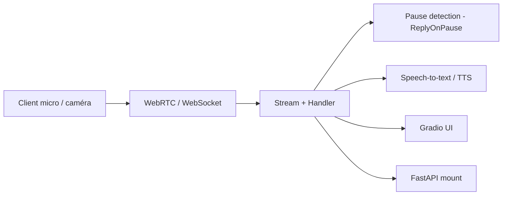

# freddyaboulton/fastrtc

> Python library that turns a function into a real-time audio or video stream via WebRTC or WebSocket.

## The problem
Connecting a model to a microphone or a camera in real time forces you to handle WebRTC, pause detection and an interface.

## What it actually does
You write a handler (for example `ReplyOnPause`) that receives audio until the user pauses and produces a reply. The `Stream` can be launched with a Gradio interface (`.ui.launch()`), mounted on FastAPI (`.mount(app)`) for WebRTC or WebSocket, or given a temporary phone number (`fastphone()`, Hugging Face token required). Extras `vad` and `tts`. The cookbook shows Gemini, OpenAI, Claude, Whisper, YOLOv10.

## How it is wired


## Trying it
```bash
pip install fastrtc
pip install "fastrtc[vad, tts]"
```
```python
stream.ui.launch()
```

## Cost and gotchas
Free; the examples call paid services (Groq, Anthropic, ElevenLabs). Last push on 2026-01-12: slower pace since then.

## What it is not
Not a voice model: it provides the transport and turn-taking. The supplied diagram is written with metaphors (Star Wars) and only contributes the list of modules.

## Alternatives
No alternative named in the README.

## For you
To adopt for prototyping a voice assistant or real-time video processing in Python; to watch on the maintenance side (one person).
