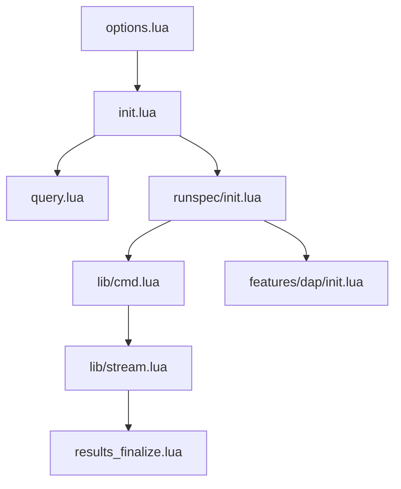

# fredrikaverpil/neotest-golang

> Neotest adapter for running and debugging Go tests in Neovim.

## The problem
Running Go tests from Neovim requires discovering the tests, building the command and reading the results.

## What it actually does
It discovers tests through the treesitter syntax tree (table tests, nested tests), builds the go test command, and streams results continuously with inline diagnostics. It handles DAP debugging with delve, monorepos and testify suites (disabled by default).

## How it is wired

## Trying it
No command documented in the README: the documentation is on an external site.

## Cost and gotchas
Free. Migrating from v1 to v2: switch nvim-treesitter to its main branch and run `:TSUpdate go`.

## What it is not
Not a standalone test runner: it assumes Neovim and Neotest.

## Alternatives
No alternative named in the README.

## For you
Ignore: only useful to Go developers on Neovim, far from data, AI or MLOps work.
