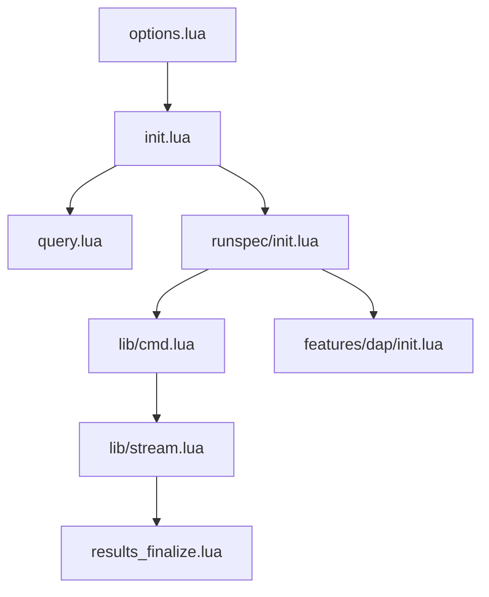

# fredrikaverpil/neotest-golang

> Adaptateur Neotest pour lancer et déboguer des tests Go dans Neovim.

## Le problème
Lancer les tests Go depuis Neovim demande de découvrir les tests, construire la commande et lire les résultats.

## Ce que ça fait vraiment
Il découvre les tests par arbre syntaxique treesitter (tests en tableau, tests imbriqués), construit la commande go test, diffuse les résultats en continu avec diagnostics en ligne. Il gère le débogage DAP avec delve, les monorepos et les suites testify (désactivées par défaut).

## Comment c'est branché

## Essayer
Aucune commande documentée dans le README : la documentation est sur un site externe.

## Coût et pièges
Gratuit. Migration de v1 vers v2 : passer nvim-treesitter sur sa branche main et lancer `:TSUpdate go`.

## Ce que ce n'est pas
Pas un lanceur de tests autonome : il suppose Neovim et Neotest.

## Alternatives
Aucune alternative nommée dans le README.

## Pour toi
À ignorer : utile seulement aux développeurs Go sous Neovim, loin d'un travail data, IA ou MLOps.

