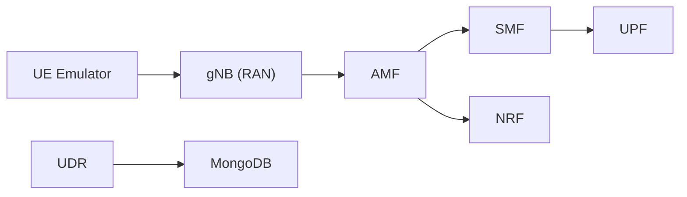

# free5gc/free5gc

> Open source implementation of the 5G mobile core network (3GPP R15), for operators, labs and telecom researchers.

## The problem
Studying or testing a 5G core without proprietary operator equipment is expensive and opaque.

## What it actually does
Minimal README: it points to the website and the guide. Based on the code, the repository groups independent network functions (AMF, SMF, UPF, NRF, UDM, UDR, AUSF, PCF, NSSF, CHF, NEF, TNGF, N3IWF), their YAML configs, their TLS certificates and a web console. The UDR relies on MongoDB. Scripts (`run.sh`, `test.sh`, `Makefile`) launch each function as a separate process.

## How it is wired

## Trying it
No command is documented in the README (everything points to free5gc.org/guide/).

## Cost and gotchas
No direct bill, but you need a RAN or an emulator and a Linux networking environment. Detailed installation is outside the README.

## What it is not
It is not a turnkey product: the installation docs are external. It is not a data science building block.

## Alternatives
No alternative named in the README.

## For you
Ignore for a data/AI/MLOps profile: a telecom domain unrelated to your work, and a README too thin to judge further.
