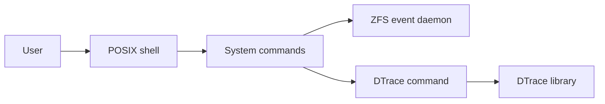

# freebsd/freebsd-src

> Source tree of the FreeBSD operating system: kernel, userland, libraries, tools.

## The problem
Building, studying or modifying a complete system (servers, desktops, embedded) from its sources.

## What it actually does
The repository brings together the kernel (`sys`), commands (`bin`, `sbin`, `usr.bin`), libraries, the boot loader (`stand`), third-party code (`contrib`, `cddl`, `crypto`), Kyua tests and release scripts. The sampled architecture shows a POSIX shell, ZFS, DTrace, TLS and an LLVM pipeline.

## How it is wired

## Trying it
No command documented in the README: it points to `build(7)`, `config(8)` and the Handbook; the root `Makefile` drives the build.

## Cost and gotchas
Free. The license is "present but not identified by GitHub": the COPYRIGHT file and the per-directory licenses are authoritative. Long, heavy build.

## What it is not
Not a ready-to-install distribution: official images come from the releases page.

## Alternatives
No alternative named in the README.

## For you
Ignore: useful only if you administer FreeBSD servers; nothing specific to data/AI.
