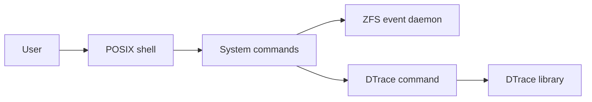

# freebsd/freebsd-src

> Arbre des sources du système d'exploitation FreeBSD : noyau, userland, bibliothèques, outils.

## Le problème
Construire, étudier ou modifier un système complet (serveurs, postes, embarqué) à partir de ses sources.

## Ce que ça fait vraiment
Le dépôt réunit noyau (`sys`), commandes (`bin`, `sbin`, `usr.bin`), bibliothèques, chargeur de démarrage (`stand`), code tiers (`contrib`, `cddl`, `crypto`), tests Kyua et scripts de publication. L'architecture échantillonnée montre shell POSIX, ZFS, DTrace, TLS et pipeline LLVM.

## Comment c'est branché

## Essayer
Aucune commande documentée dans le README : il renvoie à `build(7)`, `config(8)` et au Handbook ; le `Makefile` racine pilote la compilation.

## Coût et pièges
Gratuit. La licence est « présente mais non identifiée par GitHub » : le fichier COPYRIGHT et les licences par répertoire font foi. Compilation longue et lourde.

## Ce que ce n'est pas
Pas une distribution prête à installer : les images officielles viennent de la page de releases.

## Alternatives
Aucune alternative nommée dans le README.

## Pour toi
Ignorer : utile seulement si tu administres des serveurs FreeBSD ; rien de spécifique data/IA.

