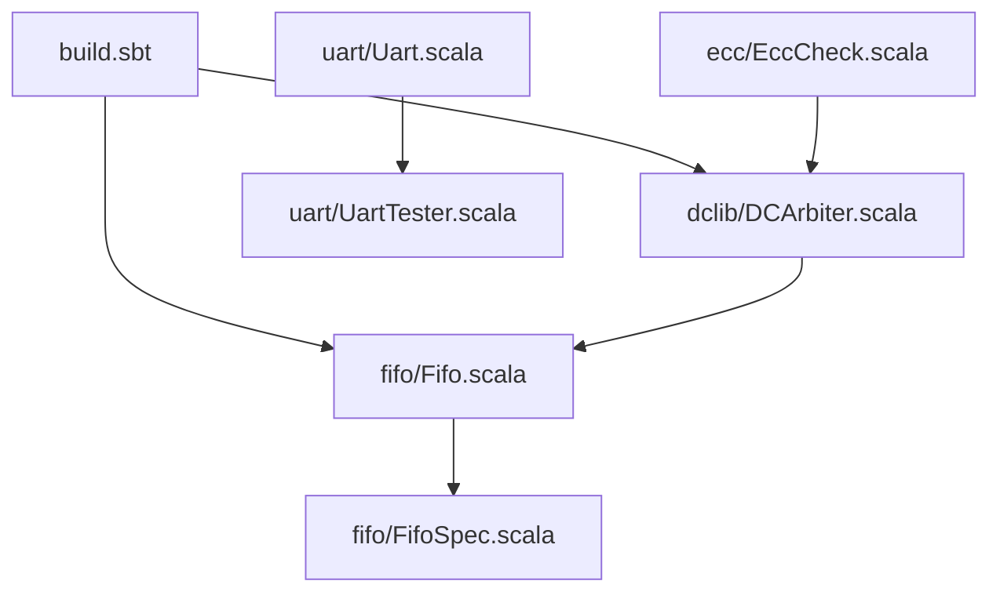

# freechipsproject/ip-contributions

> Community collection of Chisel hardware modules (FIFO, UART, ECC, filters) for circuit designers.

## The problem
Chisel designers rewrite common blocks (UART, FIFO, error correction) for lack of a shared place to exchange them.

## What it actually does
The repository organizes Chisel modules by folder: bitonic sort, iterative Cordic, UART, FIFO, Hamming ECC, FIR and IIR filters. Each module has its tests in `src/test`. Some modules live in external repositories published on Maven (aes_chisel, spi2wb). The package is published on Maven Central, with versions aligned to Chisel and Scala.

## How it is wired


## Trying it
```bash
# build.sbt
libraryDependencies += "edu.berkeley.cs" % "ip-contributions" % "5.3.0"
```

## Cost and gotchas
Scala and sbt are required (not listed in the plan's prerequisites). The README admits that the licence of the contributions is still "WIP" and the vetting section is empty.

## What it is not
Not an audited catalogue: the "Vetting" and "Publishing" sections are empty.

## Alternatives
No alternative named in the README.

## For you
Ignore: Chisel hardware design, far from the data, AI or MLOps profile.
