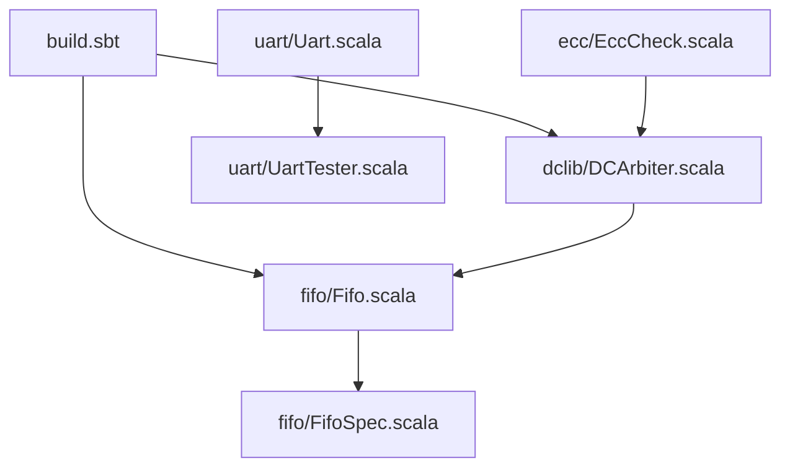

# freechipsproject/ip-contributions

> Collection communautaire de modules matériels Chisel (FIFO, UART, ECC, filtres) pour concepteurs de circuits.

## Le problème
Les concepteurs Chisel réécrivent des blocs courants (UART, FIFO, correction d'erreur) faute d'un lieu commun de partage.

## Ce que ça fait vraiment
Le dépôt range par dossier des modules Chisel : tri bitonique, Cordic itératif, UART, FIFO, Hamming ECC, filtres FIR et IIR. Chaque module a ses tests dans `src/test`. Certains modules vivent dans des dépôts externes publiés sur Maven (aes_chisel, spi2wb). Le paquet est publié sur Maven Central, avec des versions alignées sur Chisel et Scala.

## Comment c'est branché


## Essayer
```bash
# build.sbt
libraryDependencies += "edu.berkeley.cs" % "ip-contributions" % "5.3.0"
```

## Coût et pièges
Scala et sbt nécessaires (non listés dans les prérequis du plan). Le README admet que la licence des contributions reste « WIP » et la section de vérification est vide.

## Ce que ce n'est pas
Pas un catalogue audité : les sections « Vetting » et « Publishing » sont vides.

## Alternatives
Aucune alternative nommée dans le README.

## Pour toi
À ignorer : conception de matériel Chisel, loin du profil data, IA ou MLOps.

