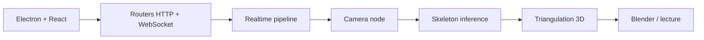

# freemocap/freemocap

> Free multi-camera motion capture system, for research, teaching and training.

## The problem
Professional motion capture is expensive and depends on proprietary hardware.

## What it actually does
A local Python server (port 8005) and a React/Electron interface: camera recording, calibration (ChArUco, Anipose or PyCeres), body keypoint detection, 3D triangulation, optional kinematics, playback and Blender export. A real-time pipeline (camera, inference, aggregation, filtering) streams the points over WebSocket. The README itself states "It might break! Work in Progress".

## How it is wired


## Trying it
```bash
pip install freemocap[cuda]
pip install freemocap[cpu]
freemocap
uv sync
uv run python freemocap/__main__.py
```

## Cost and gotchas
The `cuda` or `cpu` extra is mandatory, otherwise there is no tracking. Python 3.9 to 3.11. Dependencies (`skellytracker`, `skellycam`) come from private git repositories via `uv`: `pip install -e .` is not enough from source. Cameras are required.

## What it is not
Not a stable product: the README mentions a `development` branch with special instructions. AGPL-3.0 license: strong copyleft, including for network use.

## Alternatives
No alternative named in the README.

## For you
Watch: relevant for computer vision and research motion capture, but unstable and tied to an AGPL license.
