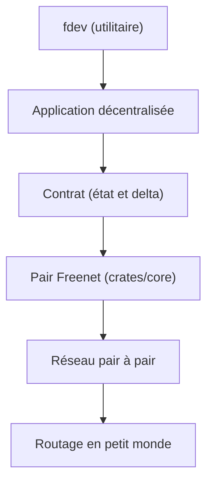

# freenet/freenet-core

> Decentralized peer-to-peer network, written in Rust, for building services without depending on a central server.

## The problem
Web services rely on centralized, siloed servers; users depend on a third party for their data.

## What it actually does
Turns users' machines into a fault-tolerant distributed platform. According to the cited white paper, the model rests on contracts (commutative idempotent monoids over application state), summary-and-delta synchronization, adaptive small-world routing, and delegates for private state. Applications are built with web frameworks and open in a browser.

## How it is wired
Simplified diagram based on the sheet, no diagram provided.


## Trying it
```bash
cargo install --path crates/core
cargo install --path crates/fdev
```

## Cost and gotchas
Free. Rust and Cargo are required to build (not listed). License present but not identified by GitHub. 617 open issues.

## What it is not
Not file storage nor a blockchain according to the README: it is a peer-to-peer service platform. Usage documentation is on the website, not in this README.

## Alternatives
No alternative cited in the README.

## For you
Ignore: a still-young decentralized platform, far from data / AI / MLOps needs.
