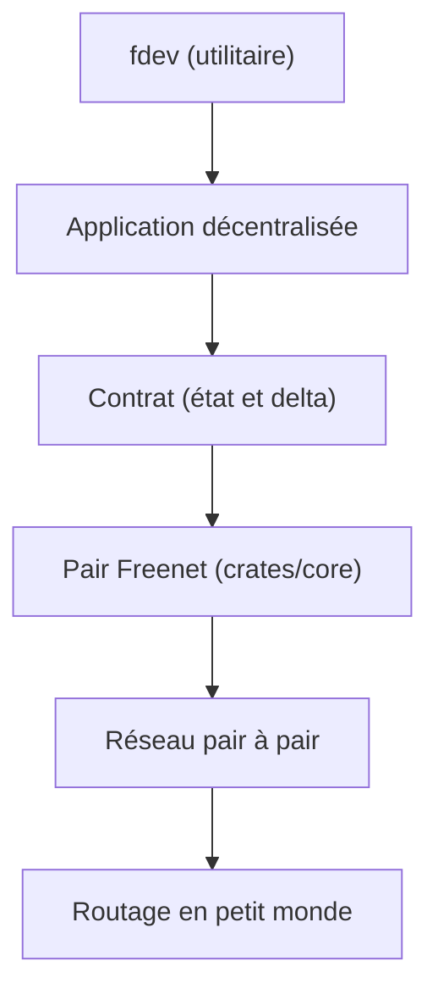

# freenet/freenet-core

> Réseau pair à pair décentralisé, écrit en Rust, pour bâtir des services sans dépendre d'un serveur central.

## Le problème
Les services web reposent sur des serveurs centralisés et cloisonnés ; l'utilisateur dépend d'un tiers pour ses données.

## Ce que ça fait vraiment
Transforme les machines des utilisateurs en plateforme distribuée tolérante aux pannes. D'après le livre blanc cité, le modèle repose sur des contrats (monoïdes commutatifs idempotents sur l'état applicatif), une synchronisation par résumé et delta, un routage adaptatif en petit monde et des délégués pour l'état privé. Les applications se construisent avec des frameworks web et s'ouvrent dans un navigateur.

## Comment c'est branché
Schéma simplifié d'après la fiche, sans diagramme fourni.


## Essayer
```bash
cargo install --path crates/core
cargo install --path crates/fdev
```

## Coût et pièges
Gratuit. Rust et Cargo requis pour compiler (hors liste). Licence présente mais non identifiée par GitHub. 617 issues ouvertes.

## Ce que ce n'est pas
Pas un stockage de fichiers ni une blockchain d'après le README : c'est une plateforme de services pair à pair. La documentation d'usage est sur le site, pas dans ce README.

## Alternatives
Aucune alternative citée dans le README.

## Pour toi
Ignorer : plateforme décentralisée encore jeune, loin des besoins data / IA / MLOps.

