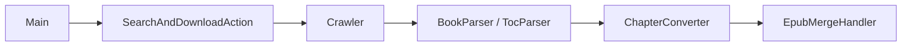

# freeok/so-novel

> Outil Java pour télécharger du contenu web de romans et l'exporter en EPUB, TXT ou PDF.

## Le problème
Lire hors ligne des romans publiés sur des sites web demande de les récupérer et de les convertir à la main.

## Ce que ça fait vraiment
Extrait des chapitres depuis des sources web à l'aide de fichiers de règles, puis les exporte en EPUB, TXT, HTML ou PDF. Trois modes : TUI, CLI et interface web. Des scripts d'installation existent pour Windows, Linux, Homebrew, Scoop et Docker. README en chinois.

## Comment c'est branché


## Essayer
```bash
bash <(curl -sSL https://raw.githubusercontent.com/freeok/so-novel/main/bin/linux-install.sh)
brew install so-novel
docker run -d --name sonovel -p 7765:7765 -e JAVA_OPTS='-Dmode=web' ghcr.io/freeok/sonovel:latest
```

## Coût et pièges
Gratuit. Le README impose de lire une clause de non-responsabilité légale ; des scripts distants sont exécutés via `curl | bash`. Licence AGPL-3.0.

## Ce que ce n'est pas
Pas un outil data : il aspire du contenu protégé par des droits, ce qui engage ta responsabilité.

## Alternatives
- Aucune alternative nommée dans le README.

## Pour toi
À ignorer : hors périmètre data/IA, avec un risque juridique lié au contenu collecté.

