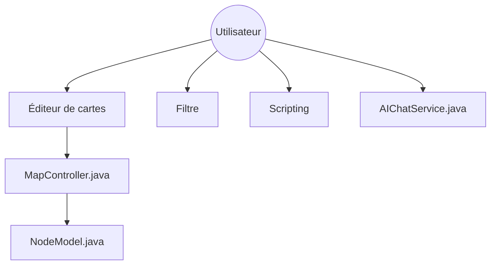

# freeplane/freeplane

> Free Java mind-mapping software, to think, organize and share information.

## The problem
Organizing ideas and linked information calls for a mapping tool that stays local and does not depend on a subscription.

## What it actually does
A Java desktop application (OSGi, Swing) to create and navigate maps of nodes, filter them, follow links and export them. The code contains extensions: scripts, formulas, code explorer, AI, Markdown, LaTeX and geographic maps. It runs on any system with Java and can be run from a USB stick.

## How it is wired

## Trying it
The README gives no command: it points to the SourceForge download and to the documentation at docs.freeplane.org.

## Cost and gotchas
Free. Java must be installed. The download is from SourceForge, not through a documented package manager.

## What it is not
It is not an AI or data science tool, despite the AI module. It is a desktop application, with no web version described.

## Alternatives
Xmind and Mindmeister, cited in the README as software that Freeplane says it can replace.

## For you
Ignore for your AI watch: a good mind-mapping tool but outside the data / MLOps scope, except for personal note-taking.
