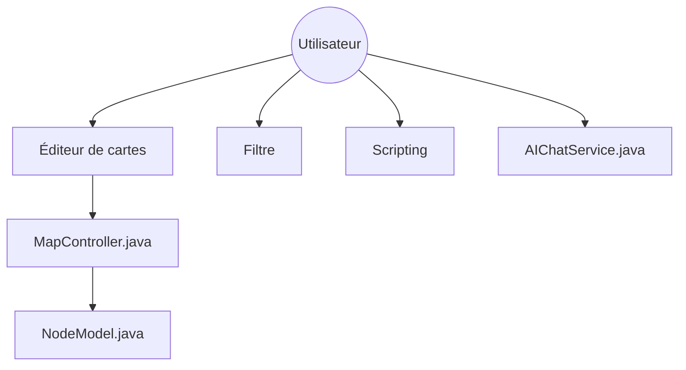

# freeplane/freeplane

> Logiciel libre de cartes mentales en Java, pour penser, organiser et partager l'information.

## Le problème
Organiser des idées et des informations liées demande un outil de cartographie qui reste local et ne dépend pas d'un abonnement.

## Ce que ça fait vraiment
Application de bureau Java (OSGi, Swing) pour créer et naviguer des cartes de nœuds, les filtrer, suivre des liens et les exporter. Le code contient des extensions : scripts, formules, explorateur de code, IA, Markdown, LaTeX et cartes géographiques. Elle tourne sur tout système avec Java et peut s'exécuter depuis une clé USB.

## Comment c'est branché

## Essayer
Le README ne donne aucune commande : il renvoie au téléchargement sur SourceForge et à la documentation sur docs.freeplane.org.

## Coût et pièges
Gratuit. Java doit être installé. Le téléchargement se fait sur SourceForge, pas via un gestionnaire de paquets documenté.

## Ce que ce n'est pas
Ce n'est pas un outil d'IA ni de data science, malgré le module d'IA. C'est une application de bureau, sans version web décrite.

## Alternatives
Xmind et Mindmeister, cités dans le README comme logiciels que Freeplane se dit capable de remplacer.

## Pour toi
Ignorer pour ton veille IA : c'est un bon outil de cartes mentales mais hors du périmètre data / MLOps, sauf usage personnel de prise de notes.

