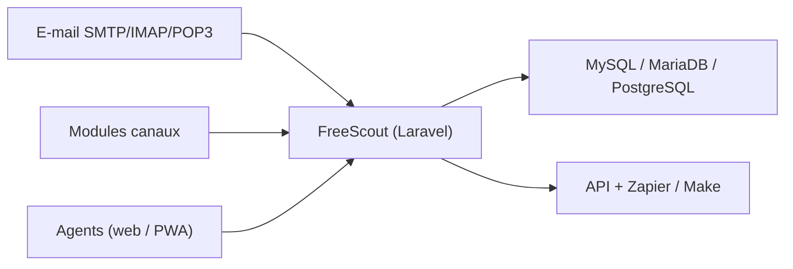

# freescout-help-desk/freescout

> Self-hosted help desk and shared inbox in PHP/Laravel, a free alternative to Zendesk and Help Scout.

## The problem
Managing customer conversations coming from several channels without depending on a proprietary SaaS service.

## What it actually does
Centralizes email, WhatsApp, Telegram, Facebook, Slack and live chat. Unlimited agents, tickets and mailboxes. Offers internal notes, conversation merging and forwarding, collision detection, auto-replies, search, a progressive web app, S3 storage and OAuth authentication for Microsoft 365 and Google Workspace. Official and community modules extend the whole; an AI writing aid is mentioned.

## How it is wired

## Trying it
No command in the README: it points to an installation guide, a Docker image and one-click installers.

## Cost and gotchas
Free for the core; some modules are probably paid (not specified in the README). Prerequisites: PHP 7.4 to 8.x, MySQL/MariaDB/PostgreSQL, Nginx/Apache/IIS.

## What it is not
Not an analytics tool. The AI mentioned is an assistance feature, not a model engine.

## Alternatives
- Zendesk and Help Scout: proprietary services that FreeScout replaces, according to the README.

## For you
Ignore: a customer support application in PHP, foreign to data/AI/MLOps work.
