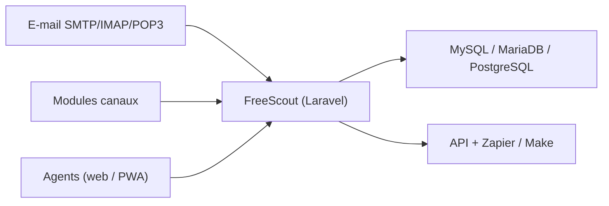

# freescout-help-desk/freescout

> Service d'assistance et boîte partagée auto-hébergé en PHP/Laravel, alternative libre à Zendesk et Help Scout.

## Le problème
Gérer des conversations clients venues de plusieurs canaux sans dépendre d'un service SaaS propriétaire.

## Ce que ça fait vraiment
Centralise e-mail, WhatsApp, Telegram, Facebook, Slack et chat en direct. Illimité en agents, tickets, boîtes. Offre notes internes, fusion et transfert de conversations, détection de collision, réponses automatiques, recherche, application web progressive, stockage S3 et authentification OAuth pour Microsoft 365 et Google Workspace. Des modules officiels et communautaires étendent l'ensemble ; une aide à la rédaction par IA est mentionnée.

## Comment c'est branché

## Essayer
Aucune commande dans le README : il renvoie à un guide d'installation, une image Docker et des installeurs en un clic.

## Coût et pièges
Gratuit pour le cœur ; certains modules sont probablement payants (non précisé dans le README). Prérequis : PHP 7.4 à 8.x, MySQL/MariaDB/PostgreSQL, Nginx/Apache/IIS.

## Ce que ce n'est pas
Pas un outil d'analyse. L'IA citée est une fonction d'assistance, pas un moteur de modèles.

## Alternatives
- Zendesk et Help Scout : services propriétaires que FreeScout remplace, selon le README.

## Pour toi
Ignorer : application de support client en PHP, étrangère à un travail data/IA/MLOps.

