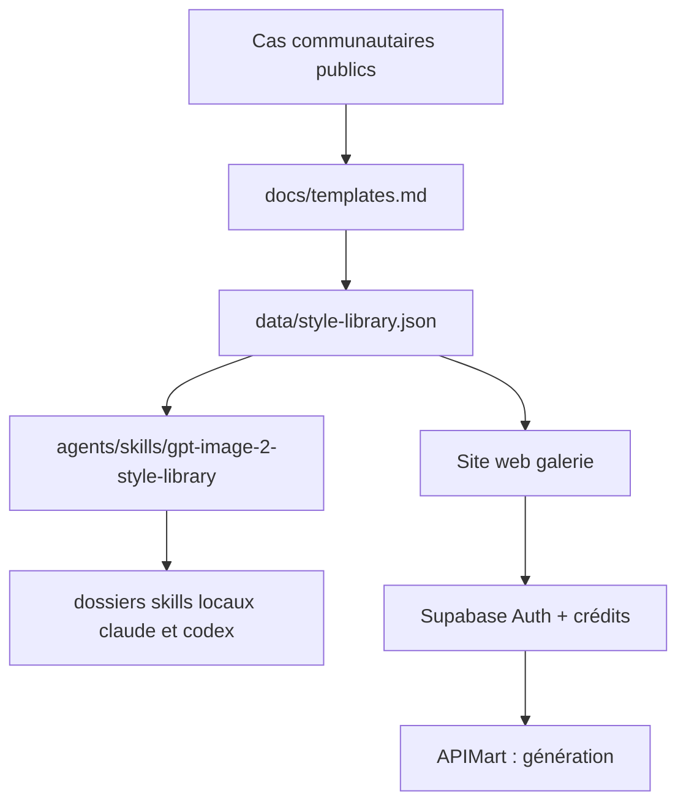

# freestylefly/awesome-gpt-image-2

> Library of 544 reverse-engineered GPT-Image2 prompt cases, plus industrial templates and a skill.

## The problem
Image generation has gone from "can it make an image?" to "can it make stable, controllable, reusable ones?".
A pile of isolated examples gives neither structure nor the ability to generate in batches.

## What it actually does
Compiles 544 public cases into "Prompt-as-Code": an atomic schema separating subjects, lighting, materials, layout and visual details into composable parts.
Sorts the cases by category (UI, infographics, posters, products, branding, architecture, photo, illustration, characters, storytelling, classical Chinese themes, documents, experiments) and provides 4 pages of prompt templates.
Ships an agent skill `gpt-image-2-style-library`, installable via `npx skills`, via the Claude Code plugin marketplace or via npm, which picks styles, templates, categories and scene tags from `data/style-library.json`.
A website (gpt-image2.canghe.ai) renders the gallery in browsable form, with generation after Google login, credits and Stripe/Alipay payments.

## How it is wired


## Trying it
```bash
npx skills add freestylefly/awesome-gpt-image-2 --skill gpt-image-2-style-library --agent claude-code codex --global --yes --copy
npm install -g gpt-image-2-style-library
gpt-image-2-style-library install all
```

## Cost and gotchas
The repository is MIT and free; generation goes through APIMart with your key, or through the site's paid credits.
The README exposes a long list of Vercel environment variables, Supabase migrations and Stripe keys: this is the code of a commercial service, not just a list.

## What it is not
It is not an image generation tool: it is a prompt catalog and a selection skill.
It is not content whose rights are guaranteed: the README states that it aggregates community prompts and images (YouMind, OpenNana) without claiming ownership, and that no commercial use is guaranteed.
It is not independent: the real added value is concentrated on a monetized third-party site.

## Alternatives
No alternative is named; the sources cited (YouMind, OpenNana) are content origins.

## For you
Little value for a data/MLOps profile: ignore, unless you occasionally need visuals for presentations.
