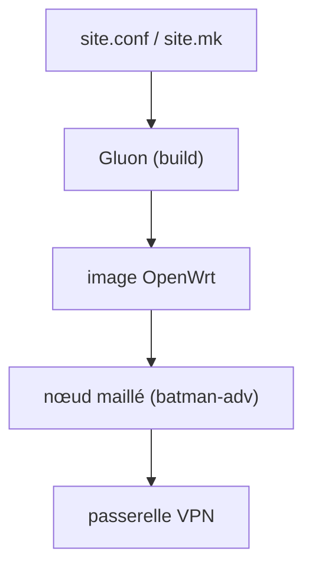

# freifunk-gluon/gluon

> Framework that builds preconfigured OpenWrt images for public mesh networks.

## The problem
Setting up a decentralized WLAN mesh network and having it run by non-specialists requires a lot of configuration.

## What it actually does
Builds an OpenWrt firmware with meshing (batman-adv IV and V, OLSRv2 partially), 802.11s links, fastd or Wireguard VPN, VXLAN. A `site.conf` and a `site.mk` customize each community. Automatic ecdsa-signed updates, a node status page, publication via respondd.

## How it is wired
Simplified diagram based on the sheet, no diagram provided.


## Trying it
```bash
git checkout v2025.1.3 && make update
```
Everything else is in the external documentation (gluon.readthedocs.io).

## Cost and gotchas
Free. Building a firmware requires an OpenWrt toolchain and compatible hardware. Do not use `main` in production: take a release. License not identified by GitHub.

## What it is not
It is not software installable on a server: it is a firmware for routers.

## Alternatives
No alternative named in the README.

## For you
Ignore: mesh networking on routers, outside the data / AI / MLOps scope.
