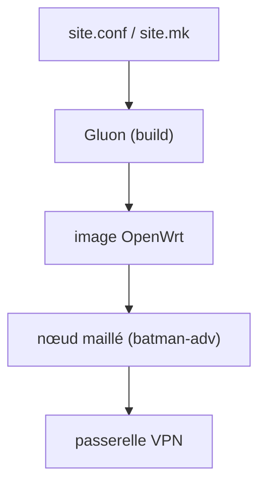

# freifunk-gluon/gluon

> Framework qui construit des images OpenWrt préconfigurées pour des réseaux maillés publics.

## Le problème
Monter un réseau maillé WLAN décentralisé et le faire gérer par des non-spécialistes demande beaucoup de configuration.

## Ce que ça fait vraiment
Fabrique un firmware OpenWrt avec maillage (batman-adv IV et V, OLSRv2 en partie), liaisons 802.11s, VPN fastd ou Wireguard, VXLAN. Un `site.conf` et un `site.mk` personnalisent chaque communauté. Mise à jour automatique signée ecdsa, page d'état du nœud, publication via respondd.

## Comment c'est branché
Schéma simplifié d'après la fiche, sans diagramme fourni.


## Essayer
```bash
git checkout v2025.1.3 && make update
```
Tout le reste est dans la documentation externe (gluon.readthedocs.io).

## Coût et pièges
Gratuit. Compiler un firmware demande une chaîne OpenWrt et du matériel compatible. Ne pas utiliser `main` en production : prendre une release. Licence non identifiée par GitHub.

## Ce que ce n'est pas
Ce n'est pas un logiciel installable sur un serveur : c'est un firmware pour routeurs.

## Alternatives
Aucune alternative nommée dans le README.

## Pour toi
À ignorer : réseau maillé sur routeurs, hors du périmètre data / IA / MLOps.

