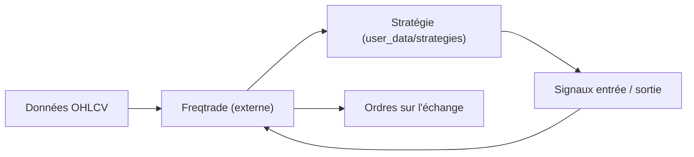

# freqtrade/freqtrade-strategies

> Collection of buy/sell strategies ready to copy into the Freqtrade crypto trading bot.

## The problem
Starting from a blank page to write a trading strategy for Freqtrade.

## What it actually does
Python files, one per strategy, in `user_data/strategies`: indicators, entry and exit signals, minimal ROI, stop-loss. Subfolders: ported strategies (berlinguyinca), futures, experimental ones with lookahead bias (lookahead_bias), plus a hyperopt file. The engine, exchanges and orders live in Freqtrade, not here.

## How it is wired


## Trying it
```bash
freqtrade backtesting --strategy Strategy001
freqtrade download-data --days 100
freqtrade trade --strategy Strategy001
```

## Cost and gotchas
Free, but the financial risk is real: the README asks for backtesting then simulation before any money is committed, with no guarantee. Results depend on pairs, period and exchange. Compatible with Freqtrade 2022.4 or newer.

## What it is not
Not "ready-to-use" strategies: the README presents them as starting points, to be optimized.

## Alternatives
No alternative named in the README.

## For you
Ignore unless you have a trading project: these are classic technical rules, with no proof of profitability, and real use exposes you to losses.
