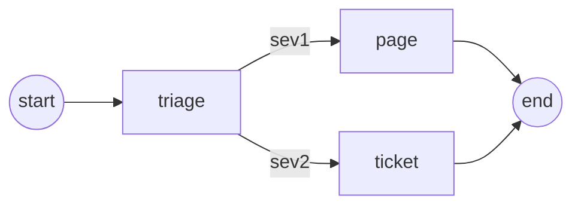

# freshaengineering/lang_ex

> Elixir library for stateful LLM agents, inspired by LangGraph, with checkpoints and human validation.

## The problem
An agent that calls tools must survive failures and wait for a human without losing its state.

## What it actually does
You describe a graph of nodes and edges, compiled then run with `invoke`. Checkpointers (memory, Redis, Postgres) let you resume a thread after a failure. `interrupt/1` pauses the run for a human. It covers streaming, agent teams (swarm, supervisor) and middlewares for summarization, approval and call budgets. Providers: Anthropic, OpenAI, Gemini.

## How it is wired


## Trying it
```bash
elixir examples/scripts/01_quick_start.exs
```
Dependency: `{:lang_ex, "~> 0.13.0"}` in `mix.exs`.

## Cost and gotchas
Provider API key at your expense (`ANTHROPIC_API_KEY`, `OPENAI_API_KEY` or `GEMINI_API_KEY`); most examples run offline. Version 0.13, so the API may still change. Redis and Postgres are optional.

## What it is not
Not a port of LangGraph: it takes inspiration from it without copying its API. It targets Elixir projects, not Python.

## Alternatives
No alternative named in the README other than LangGraph, a mere source of inspiration.

## For you
Worth watching: interesting to see how resumable agents are built on the BEAM, but useful only if you do Elixir.
