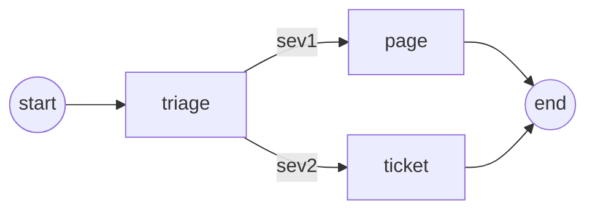

# freshaengineering/lang_ex

> Bibliothèque Elixir pour agents LLM à état, inspirée de LangGraph, avec points de reprise et validation humaine.

## Le problème
Un agent qui appelle des outils doit survivre aux pannes et attendre un humain sans perdre son état.

## Ce que ça fait vraiment
Tu décris un graphe de nœuds et d'arêtes, compilé puis exécuté avec `invoke`. Des checkpointers (mémoire, Redis, Postgres) permettent de reprendre un fil après une panne. `interrupt/1` met le run en pause pour un humain. Il couvre le streaming, les équipes d'agents (swarm, supervisor) et des middlewares de résumé, d'approbation et de budget d'appels. Fournisseurs : Anthropic, OpenAI, Gemini.

## Comment c'est branché


## Essayer
```bash
elixir examples/scripts/01_quick_start.exs
```
Dépendance : `{:lang_ex, "~> 0.13.0"}` dans `mix.exs`.

## Coût et pièges
Clé d'API du fournisseur à ta charge (`ANTHROPIC_API_KEY`, `OPENAI_API_KEY` ou `GEMINI_API_KEY`) ; la plupart des exemples tournent hors ligne. Version 0.13, donc l'API peut encore bouger. Redis et Postgres sont optionnels.

## Ce que ce n'est pas
Ce n'est pas un portage de LangGraph : il s'en inspire sans en copier l'API. Il s'adresse aux projets Elixir, pas à Python.

## Alternatives
Aucune alternative nommée dans le README autre que LangGraph, simple source d'inspiration.

## Pour toi
À surveiller : intéressant pour voir comment des agents à reprise se bâtissent sur la BEAM, mais utile seulement si tu fais de l'Elixir.

