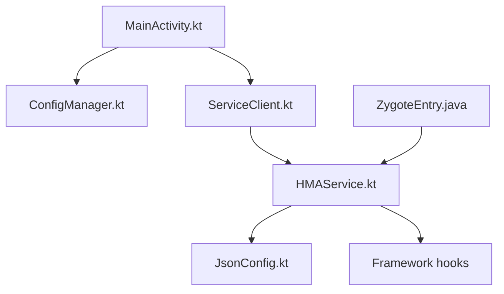

# frknkrc44/HMA-OSS

> Android Zygisk module that hides applications and denies app-list queries.

## The problem
Some applications detect certain installed software (and therefore a rooted device) or collect your app list to track you.

## What it actually does
A management app configures the scope and the filters. A Zygote-side service reads this JSON configuration and installs hooks on Android's package manager APIs to hide the chosen apps. Pre-saved templates (presets) make tuning easier. The README targets privacy protection; the effect is also to hide root from apps that detect it.

## How it is wired


## Trying it
```bash
# Aucune commande documentée : le wiki du projet (HMA-OSS/wiki) sert de guide.
```

## Cost and gotchas
Free, AGPL-3.0 license. You need a rooted phone with Zygisk. Not all the interface-to-service links are verified in the architecture provided.

## What it is not
Not an enterprise security tool nor a guaranteed anti-detection tool: applications can bypass the hiding. It is useless outside rooted Android.

## Alternatives
No alternative named in the README.

## For you
Ignore: an Android tool for rooting and hiding apps, unrelated to data, AI or MLOps work.
