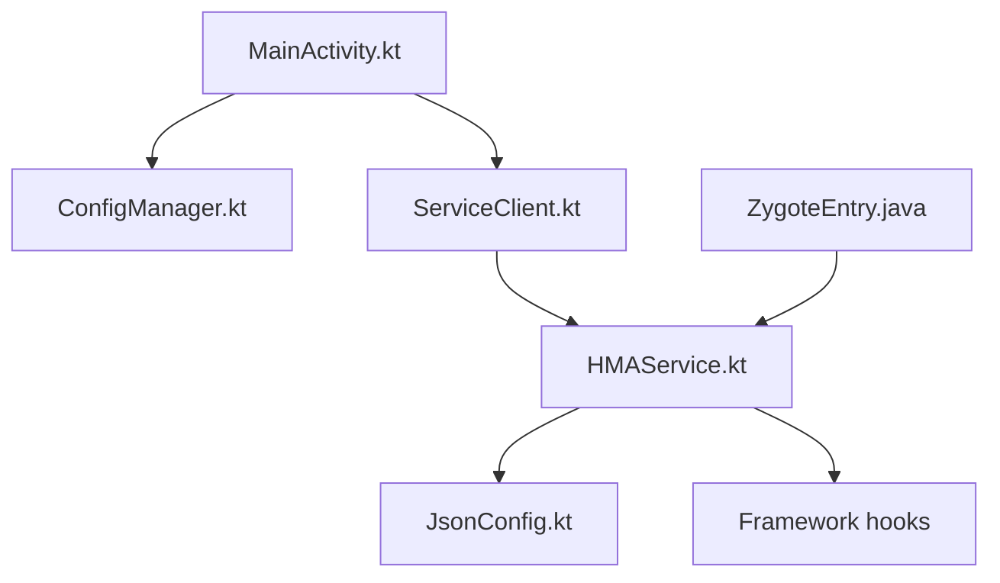

# frknkrc44/HMA-OSS

> Module Zygisk Android qui masque des applications et refuse les requêtes de liste d'applis.

## Le problème
Des applications détectent certains logiciels installés (donc un appareil rooté) ou collectent ta liste d'applis pour te pister.

## Ce que ça fait vraiment
Une appli de gestion configure le périmètre et les filtres. Un service côté Zygote lit cette configuration JSON et installe des hooks sur les API du gestionnaire de paquets d'Android pour cacher les applis choisies. Des modèles préenregistrés (presets) facilitent le réglage. Le README cible la protection de la vie privée ; l'effet est aussi de masquer un root aux applis qui le détectent.

## Comment c'est branché


## Essayer
```bash
# Aucune commande documentée : le wiki du projet (HMA-OSS/wiki) sert de guide.
```

## Coût et pièges
Gratuit, licence AGPL-3.0. Il faut un téléphone rooté avec Zygisk. Les liens interface vers service ne sont pas tous vérifiés dans l'architecture fournie.

## Ce que ce n'est pas
Pas un outil de sécurité d'entreprise ni un anti-détection garanti : les applications peuvent contourner le masquage. Il ne sert à rien hors Android rooté.

## Alternatives
Aucune alternative nommée dans le README.

## Pour toi
À ignorer : outil Android pour rooter et masquer des applis, sans rapport avec un travail data, IA ou MLOps.

