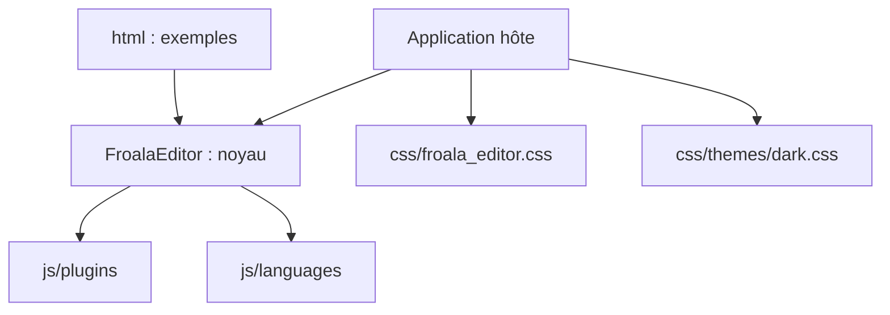

# froala/wysiwyg-editor

> JavaScript WYSIWYG rich-text editor, sold under a commercial license, with more than thirty plugins.

## The problem
Integrating a complete, extensible and localized rich-text editor into a web application.

## What it actually does
You instantiate `FroalaEditor` on a textarea, then load plugins (images, tables, alignment...), themes and languages as needed. It loads through npm, bower or CDN, as AMD, CommonJS or ES module, with TypeScript declarations. PHP server examples show media upload to S3-compatible storage; integrations exist for many frameworks.

## How it is wired


## Trying it
```bash
npm install froala-editor
```
```javascript
new FroalaEditor('#edit');
```

## Cost and gotchas
Paid: all plugins are restricted without a license; a time-limited trial requires registering a trial license, then a commercial license. The license is "present but unidentified" according to GitHub, and more than 430 issues are open.

## What it is not
It is not free software in the usual sense despite the code being present. It is not an upload service: storage must be written on the server side.

## Alternatives
No alternative named in the README.

## For you
Ignore: a commercial licensed editor, useless for a data or AI profile, who has no reason to pay for a web component.
